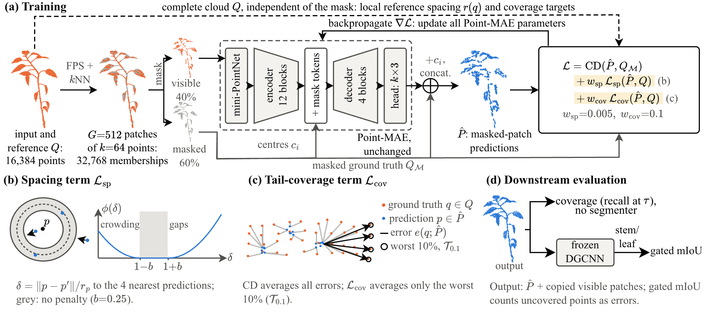
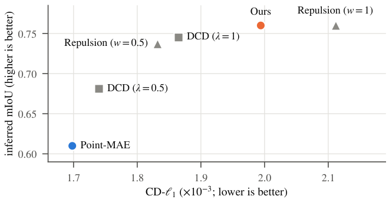
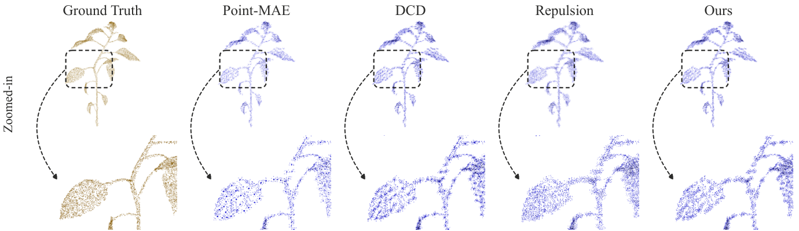

# What Chamfer Distance Misses

Code and results for **"What Chamfer Distance Misses: Coverage and Point Distribution in Masked Reconstruction of Plant Point Clouds"**, accepted at the WACV 2027 workshop HARVEST-Vision.

Sanjog Gaihre, Ali Torabi, Md Mahbubur Rahman, Md Omor Faruk, Yaqoob Majeed. University of Wyoming.

## Overview

Chamfer distance (CD) is the usual loss and metric for point-cloud reconstruction, but a low CD can hide clustered predictions and uncovered surface. We study this with Point-MAE on the Pepper-4D dataset.

We add two terms to CD on the assembled output cloud:
- a **two-sided local spacing term**
- a **tail-coverage term** on the 10% of ground-truth points that are worst covered

We evaluate the reconstructions with geometric metrics and a frozen DGCNN stem/leaf segmenter. Across six objectives, a lower CD-ℓ1 goes with worse segmentation of the generated points. Our terms raise gated mIoU by 0.079 over Point-MAE, and an ablation traces nearly all of the gain to the spacing term.

The `wacv2027-submission` tag marks the code as submitted for review.

<p align="center">
  
</p>

*Method overview. (a) Masked predictions shifted by patch centres form the assembled cloud. Assembled CD-ℓ1 against the masked target replaces per-patch CD, and the spacing and coverage terms use the complete cloud. (b) Local spacing and (c) tail coverage. (d) A frozen DGCNN evaluates the complete output.*

## Results at a glance

<p align="center">
  
</p>

*Complete-cloud CD-ℓ1 against inferred mIoU for the six objectives evaluated downstream. A lower CD goes with worse segmentation of the generated points.*

<p align="center">
  
</p>

*One leaf from the test frame with the median recall gain of ours over Point-MAE. Point-MAE clusters and leaves gaps, DCD (α = 50, λ = 1) keeps clusters, repulsion (w_rep = 1) is even but strays off the leaf, and ours lies between.*

| | Generated-point coverage at τ | Gated mIoU | Inferred stem IoU |
|---|---|---|---|
| Point-MAE | 9.5% | 0.397 | 0.371 |
| Ours | 20.3% | 0.476 | 0.622 |

## Repository layout

```
what-cd-misses/
├── pointmae/            Point-MAE code with our loss terms, configs and evaluation
│   ├── models/          Point_MAE.py, uniform_loss.py (our terms), build.py
│   ├── cfgs/            all training configs used in the paper
│   ├── datasets/        Pepper-4D data loaders
│   ├── extensions/      Chamfer / EMD CUDA extensions (build before use)
│   ├── tools/, utils/   training loop, builders, utilities
│   ├── main.py          training entry point
│   ├── eval_ckpt_claude_v2.py   reconstruction export and geometric evaluation
│   └── figures/, renders/       working figures and render outputs
├── downstream/          frozen DGCNN segmentation, statistics and result CSVs
│   ├── seg_downstream.py        segmentation of reconstructions
│   ├── seg_stats.py             paired bootstrap confidence intervals
│   ├── final_checks.py          summary checks (cdf and seg modes)
│   ├── per_organ_recall.py, summarize_per_organ.py, per_organ_figures.py
│   ├── seg_dgcnn_s{0,1,2}.pth   frozen segmenter weights (3 seeds)
│   └── *.csv                    per-run and per-frame results used in the paper
├── paper/               figures used in the paper and this README
│   └── figures/         final figures used in the paper
│       └── png/         PNG copies of the PDF figures for this README
└── requirements.txt     pip freeze of the training environment
```

Checkpoints, reconstructions and the dataset are **not** in git. On MedicineBow they live at:

| Item | Location |
|---|---|
| Final checkpoints of all 39 runs (read-only archive) | `/project/cvanddl-cea/sgaihre/what-cd-misses/checkpoints/experiments/<config>/cfgs/<exp_name>/ckpt-last.pth` |
| Training logs | `/project/cvanddl-cea/sgaihre/what-cd-misses/checkpoints/logs/` |
| Exported reconstructions (`*_gt.ply`, `*_rec.ply`) | `/project/cvanddl-cea/sgaihre/cdf_stats/<model>/` |
| Pepper-4D data | `/project/cvanddl-cea/sgaihre/Temporal_growth_prediction/Pepper_dataset/` |

## Paper terms in the code

| Paper | Code (`pointmae/models/uniform_loss.py`) | Config key |
|---|---|---|
| Spacing term L_sp (8-NN reference, 4 predicted neighbours, b = 0.25) | `spacing_loss(pred, gt, k=4, band=0.25)` with `gt_spacing_local(gt, k=8)` | `w_spacing` |
| Tail-coverage term L_cov (worst 10%) | `hole_loss(pred, gt, q=0.1)` | `w_hole` |
| PU-Net repulsion baseline | `repulsion_loss(pred, k=5, h)` | `w_repulsion`, `repulsion_h` |
| Density-aware CD baseline | `dcd(pred, gt, alpha, n_lambda)` | `use_dcd_loss`, `dcd_alpha`, `dcd_lambda` |

The losses are added to the total in `Point_MAE.py`. The code defaults (`repulsion_h=0.028`, `dcd_alpha=1000`) differ from the paper settings (h = 0.007, α = 50 and 200), which are set in the configs. Paper setting for ours: `w_spacing = 0.005`, `w_hole = 0.1`.

## Setup

```bash
pip install -r requirements.txt
```

Then build the CUDA extensions as described in `pointmae/README.md` (the original Point-MAE instructions). On MedicineBow, load the matching CUDA toolkit module first.

## Data

Download Pepper-4D from https://github.com/foysalahmed10/Pepper-4D and cite the dataset paper (Ahmed et al., *Plants* 15(4):599, 2026).

The expected layout is `Pepper_dataset/subset_N/plant_NN/frames/<ID>_Day_NN.txt`.

- **Split:** plant-disjoint. 685 training frames (21 plants), 120 validation (4 plants), 111 test (4 plants).
- **Sampling:** each frame is subsampled uniformly at random to 16,384 points. It is redrawn at every training load and fixed by a per-frame seed at evaluation.
- **Normalisation:** clouds are centred at the estimated stem base and divided by one scale computed on the training split.

Update the data paths in the dataset configs before running elsewhere.

## Training

Run from `pointmae/`, one run per GPU:

```bash
CUDA_VISIBLE_DEVICES=0 nohup python main.py --config cfgs/<config>.yaml --exp_name <name> --seed 0 \
  > logs/<name>_train.log 2>&1 &
```

- **Shared settings:** 300 epochs, AdamW (lr 1e-4, weight decay 0.05), cosine schedule with 5 warm-up epochs.
- **Batch:** global batch 4 with 8-step gradient accumulation. `total_bs` is the global batch and is divided across GPUs.
- **Model:** mask ratio 0.6, 512 patches of 64 points.
- **Extra seeds:** the two extra DCD runs use `cfgs/dcd_a50.yaml` with `--seed 1` and `--seed 2` on one H100 (exp names `dcd_a50_seed1`, `dcd_a50_seed2`).

Checkpoints are written to `experiments/<config>/cfgs/<exp_name>/`.

## Evaluation

**Complete output** (generated patches plus copied visible patches, subsampled to 16,384 points):

```bash
python eval_ckpt_claude_v2.py --config <cfg> --ckpt <ckpt> --out_dir <cdf_stats>/<name> \
  --dense_only --mask_ratio 0.6 --n_points 16384 --no_emd
```

**Generated points only**, density-matched to 16,384 points:

```bash
python eval_ckpt_claude_v2.py --config <cfg> --ckpt <ckpt> --out_dir <cdf_stats>/<name>_match_density \
  --mode masked --mask_ratio 0.6 --match_density --no_emd
```

Always use `--match_density` for generated-only numbers. Without it, recall is inflated.

**Downstream segmentation** (from `downstream/`):
1. Run `seg_downstream.py` once per segmenter seed (`--ckpt seg_dgcnn_s{0,1,2}.pth`, `--seed`, `--out`).
2. Run `seg_stats.py` (`--files`, `--ref`, `--n_boot 10000`) for paired bootstrap CIs, stratified by plant.
3. `final_checks.py` summarises reconstruction (`cdf`) and segmentation (`seg`) results.

`seg_downstream.py` retrains the segmenter if a checkpoint is missing, and `--out` overwrites, so keep the provided `.pth` files and CSVs.

Scripts contain absolute MedicineBow paths. Edit them for other systems.

## Results in this repository

| Paper item | Source |
|---|---|
| Table 1, Table 2 (complete outputs, spacing sweep, term ablation) | `eval_ckpt_claude_v2.py` on each checkpoint, summarised with `final_checks.py cdf` |
| Generated-only coverage (Sec. 5.2) | `eval_ckpt_claude_v2.py --mode masked --match_density` |
| Table 3 (segmentation) | `downstream/seg_s{0,1,2}.csv` and `seg_stats.csv` (ablations: `abl*_seg_s*.csv`, `abl_seg_stats.csv`; second seed: `seed2_s*.csv`; extra DCD seeds: `dcdseed_s*.csv`, `dcdseed_stats.csv`) |
| Per-organ coverage (Sec. 5.4) | `downstream/per_organ_*.csv`, from `per_organ_recall.py` and `summarize_per_organ.py` |
| Figures | Final versions in `paper/figures/`. Generated with `pointmae/make_cd_scatter.py`, `make_figures.py`, `make_qualitative.py` and `render_views.py` (working outputs in `pointmae/figures/`) |
| Reference duplicates and r(q) checks (Sec. 3.4) | `downstream/gt_checks.py` on the saved `*_gt.ply` test clouds |
| Computational cost (Sec. 5.7) | `pointmae/timing_audit.py` and the training logs |

## Citation

```bibtex
@inproceedings{gaihre2027cdmisses,
  title     = {What Chamfer Distance Misses: Coverage and Point Distribution in Masked Reconstruction of Plant Point Clouds},
  author    = {Gaihre, Sanjog and Torabi, Ali and Rahman, Md Mahbubur and Faruk, Md Omor and Majeed, Yaqoob},
  booktitle = {IEEE/CVF Winter Conference on Applications of Computer Vision (WACV) Workshops},
  year      = {2027}
}
```

## Acknowledgements

`pointmae/` builds on Point-MAE (Pang et al., ECCV 2022) and keeps its original license (`pointmae/LICENSE`). Experiments ran on the MedicineBow cluster at the University of Wyoming Advanced Research Computing Center (ARCC).